# BookNest

<div align="center">

**A calm, personal reading library for tracking the books you want to read, the books you are reading, and the stories you have finished.**

[](https://nextjs.org/)
[](https://react.dev/)
[](https://tailwindcss.com/)
[](https://nodejs.org/)
[](https://www.mongodb.com/)

</div>

---

## Overview

**BookNest** is a full-stack personal reading tracker with secure authentication and private, user-owned book collections. It combines a focused reading-library interface with an Express REST API and MongoDB persistence.

The interface follows a warm, minimal editorial style: stone surfaces, neutral charcoal actions, amber highlights, and clear typography. Every primary interaction is designed to feel quiet, direct, and easy to scan.

---

## Core Features

| Feature | Implementation |
|---|---|
| Account authentication | Signup, login, logout, current-user lookup, and protected routes |
| Personal library | Each authenticated user sees only books linked to their own account |
| Reading status | **Want to Read**, **Reading**, and **Finished** |
| Book management | Create, view, edit, and delete books |
| Cover support | Optional cover image URL displayed as a contained cover preview |
| Ratings | Optional 1–5 rating available only for finished books |
| Personal notes | Long-form notes stored alongside each book |
| Search | Case-insensitive title or author search |
| Status filtering | Filter the library by reading status |
| Empty and loading states | Purpose-built feedback for new users, searches, and requests |
| Session persistence | HTTP-only JWT cookie restored by the frontend auth provider |
| API validation | Centralized request validation and consistent error responses |

---

## Technology Stack

### Frontend

- **Framework:** Next.js 16 App Router
- **UI Library:** React 19
- **Styling:** Tailwind CSS 4 + custom global styles
- **Client State:** Zustand
- **HTTP Client:** Axios with credential support
- **Font:** Arial, Helvetica, sans-serif

### Backend

- **Runtime:** Node.js
- **Framework:** Express 5
- **Database:** MongoDB through Mongoose 9
- **Authentication:** JWT stored in HTTP-only cookies
- **Password Security:** bcryptjs
- **Validation:** express-validator
- **Security Middleware:** Helmet and CORS

---

## Visual System

The implemented interface uses the same visual tokens throughout the application.

| Role | Token | Usage |
|---|---|---|
| Canvas | `stone-50` | Main page background |
| Surface | `white` | Cards, forms, and navigation surfaces |
| Border | `stone-200` / `stone-300` | Dividers and input borders |
| Primary action | `gray-900` | Main buttons and navigation actions |
| Primary hover | `gray-700` | Button hover state |
| Accent | `amber-700` | Brand mark, ratings, and links |
| Accent hover | `amber-800` | Secondary accent links |
| Muted text | `gray-500` / `gray-600` | Supporting copy and metadata |
| Error | `red-600` / `red-50` | Destructive actions and error states |

**Typography**

- Font family: `Arial, Helvetica, sans-serif`
- Headings: Semibold weight with tight tracking
- Body copy: Regular weight with comfortable line height
- UI labels and actions: Small to medium text with medium or semibold weight
- Brand treatment: `BookNest.` with an amber period accent

---

## Architecture

```mermaid
flowchart LR
    A["Browser"] --> B["Next.js Frontend"]
    B --> C["Axios API Client"]
    C -->|"Cookie + JSON"| D["Express API"]
    D --> E["JWT Middleware"]
    E --> F["Controllers"]
    F --> G["Request Validators"]
    G --> H["Mongoose Models"]
    H --> I[(MongoDB)]

    B --> J["Zustand Stores"]
    J --> C

    style A fill:#fafaf9,stroke:#d6d3d1,color:#111827
    style B fill:#111827,stroke:#111827,color:#ffffff
    style C fill:#292524,stroke:#292524,color:#ffffff
    style D fill:#b45309,stroke:#b45309,color:#ffffff
    style I fill:#f5f5f4,stroke:#d6d3d1,color:#111827
```



### Request Flow

1. The Next.js client calls the backend through Axios.
2. Axios sends requests with credentials so the JWT cookie is included.
3. Express applies Helmet, CORS, JSON parsing, and cookie parsing.
4. Protected book routes pass through authentication middleware.
5. Express-validator checks incoming form data.
6. Controllers perform ownership-aware CRUD operations.
7. Mongoose persists users and books in MongoDB.
8. The centralized error middleware returns a consistent response.

---

## Feature Folder Structure

```text
NESTBOOK/
├── frontend/
│   ├── public/                       # Static public assets
│   └── src/
│       ├── app/                      # Next.js App Router
│       │   ├── layout.js             # Root layout and auth provider
│       │   ├── page.js               # Landing page
│       │   ├── globals.css           # Tailwind and global styles
│       │   ├── login/page.js         # Login experience
│       │   ├── signup/page.js        # Account creation
│       │   └── books/
│       │       ├── page.js           # Library, search, and filters
│       │       ├── add/page.js       # Add-book workflow
│       │       └── [id]/
│       │           ├── page.js       # Book details
│       │           └── edit/page.js  # Edit-book workflow
│       ├── components/
│       │   ├── Navbar.js             # Authentication-aware navigation
│       │   ├── BookCard.js           # Library card and delete action
│       │   └── BookForm.js           # Shared add/edit form
│       ├── context/
│       │   └── AuthProvider.js       # Restores authentication on refresh
│       ├── services/
│       │   ├── api.js                # Shared Axios configuration
│       │   ├── authService.js        # Authentication endpoints
│       │   └── bookService.js        # Book endpoints
│       └── store/
│           ├── authStore.js          # Authentication state
│           └── bookStore.js          # Library and filter state
│
└── backend/
    ├── app.js                        # Middleware and route registration
    ├── server.js                     # Database connection and listener
    ├── config/
    │   └── db.js                     # MongoDB connection
    ├── controllers/
    │   ├── authController.js         # Authentication operations
    │   └── bookController.js         # Book CRUD operations
    ├── middleware/
    │   ├── authMiddleware.js         # JWT route protection
    │   ├── errorMiddleware.js        # Centralized error responses
    │   └── validateMiddleware.js     # Validation result handling
    ├── models/
    │   ├── User.js                   # User schema
    │   └── Book.js                   # Book schema
    ├── routes/
    │   ├── authRoutes.js             # Authentication endpoints
    │   └── bookRoutes.js             # Protected book endpoints
    ├── utils/
    │   ├── AppError.js               # Operational error type
    │   ├── generateToken.js          # JWT generation
    │   └── logger.js                 # Logging utility
    └── validators/
        ├── authValidator.js          # Signup and login rules
        └── bookValidator.js          # Book field rules
```

---

## Data Models

### User

| Field | Type | Rules |
|---|---|---|
| `name` | String | Required and trimmed |
| `email` | String | Required, unique, lowercase, and trimmed |
| `password` | String | Required, minimum 6 characters, stored hashed |
| `timestamps` | Date | Created and updated automatically |

### Book

| Field | Type | Rules |
|---|---|---|
| `userId` | ObjectId | References the owning `User` |
| `title` | String | Required and trimmed |
| `author` | String | Required and trimmed |
| `coverImage` | String | Optional URL, empty by default |
| `status` | String | Want to Read, Reading, or Finished |
| `rating` | Number | 1–5; allowed for finished books |
| `notes` | String | Optional personal notes |
| `timestamps` | Date | Created and updated automatically |

---

## API Reference

**Base URL:** `http://localhost:5001/api`

### Authentication

| Method | Endpoint | Access | Description |
|---|---:|---|---|
| `POST` | `/auth/signup` | Public | Create an account and set an auth cookie |
| `POST` | `/auth/login` | Public | Log in and set an auth cookie |
| `POST` | `/auth/logout` | Public | Clear the auth cookie |
| `GET` | `/auth/me` | Protected | Return the current authenticated user |

### Books

| Method | Endpoint | Access | Description |
|---|---:|---|---|
| `GET` | `/books` | Protected | List owned books; supports `status` and `search` queries |
| `POST` | `/books` | Protected | Add a book |
| `GET` | `/books/:id` | Protected | Get one owned book |
| `PUT` | `/books/:id` | Protected | Update one owned book |
| `DELETE` | `/books/:id` | Protected | Delete one owned book |

### Health Check

```text
GET /api/health
```

Returns a success response when the API process is running.

---

## Local Setup

### Prerequisites

- Node.js 18 or newer
- npm
- A MongoDB database, local or hosted

### 1. Clone the Repository

```bash
git clone <repository-url>
cd NESTBOOK
```

### 2. Configure the Backend

Create `backend/.env`:

```env
PORT=5001
NODE_ENV=development
MONGO_URI=mongodb://127.0.0.1:27017/booknest
JWT_SECRET=replace-with-a-long-random-secret
FRONTEND_URL=http://localhost:3000
```

### 3. Configure the Frontend

Create `frontend/.env.local`:

```env
NEXT_PUBLIC_API_URL=http://localhost:5001/api
```

### 4. Install Dependencies

```bash
cd backend
npm install

cd ../frontend
npm install
```

### 5. Start the Application

Run the API:

```bash
cd backend
npm run dev
```

Run the frontend in a second terminal:

```bash
cd frontend
npm run dev
```

Open **http://localhost:3000**.

The API health endpoint is available at **http://localhost:5001/api/health**.

---

## Available Scripts

### Backend

```bash
npm run dev    # Start with Nodemon
npm start      # Start the production process
```

### Frontend

```bash
npm run dev    # Start the Next.js development server
npm run build  # Create a production build
npm start      # Serve the production build
npm run lint   # Run ESLint
```

---

## Security Notes

- Passwords are hashed with bcrypt before storage.
- Authentication uses a signed JWT.
- The JWT is stored in an HTTP-only cookie.
- Authentication middleware protects every book route.
- Book queries are scoped by `userId`, preventing access to another user's books.
- Production cookies use secure and cross-site settings.
- Helmet adds security-related HTTP headers.
- CORS is limited by the configured frontend origin.
- Inputs are validated before controllers are executed.

Keep `JWT_SECRET` and `MONGO_URI` private. Never commit real environment files or database credentials.

---

## Production Considerations

- Use HTTPS for both frontend and backend domains.
- Set `NODE_ENV=production`.
- Use a strong, unique `JWT_SECRET`.
- Configure a managed MongoDB deployment.
- Set `FRONTEND_URL` to the deployed frontend origin.
- Set `NEXT_PUBLIC_API_URL` to the deployed API base URL.
- Review cookie domain and cross-origin behavior for your hosting provider.

---

<div align="center">

**BookNest** — *A little space for your reading journey.*

</div>
